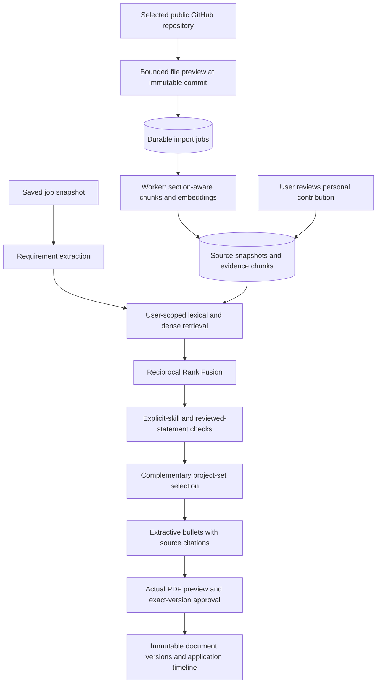

# Evidence-backed project selection

The user decision is: which projects support this job, and what can I truthfully say about my contribution?

## Retrieval is not verification

An embedding is a learned numerical representation used to locate related text. It does not prove that a claim is true or that the account holder authored the code. FastEmbed uses `BAAI/bge-small-en-v1.5`, producing 384-dimensional vectors locally. Vectors carry a model/version identifier; incompatible versions are excluded. The lexical mode is an explicitly labeled baseline, not a fake vector implementation.

Public GitHub files are pinned to a commit. Preview is limited to 16 files, 48 KB per file and 500 KB total, with an overall request deadline. Common generated paths, credentials, lockfiles, binary data and recognizable secret patterns are excluded. This is not a guarantee of secret detection; users must inspect the preview. Private repositories and OAuth/App installation flows are not included.

The durable worker claims jobs atomically, uses leases, retries at most three times with backoff, honors cancellation, and stores completion. Unchanged content with matching contribution context and embedding version reuses its embedding and review. Importing a newer snapshot supersedes the prior active snapshot for that repository. Old approved documents remain historical records; attaching documents with changed or unavailable evidence is rejected.

## Ranking

Requirements are extracted deterministically from the supplied text. PostgreSQL uses a tenant-scoped pgvector exact similarity query and full-text candidates; SQLite provides a bounded local compatibility path. Candidates are ranked by explicit token overlap and cosine similarity, then combined using Reciprocal Rank Fusion. Exact technology names are preserved, including C, C++, C#, Go and R.

Only an approved contribution statement can produce a personal resume bullet. An explicit technology requirement must appear in the cited source. Technology and numeric claims not present in the source are rejected during contribution review. These are conservative checks, not a semantic fact-verification proof. Requirements without sufficient reviewed evidence remain partial or missing.

Project selection maximizes weighted requirement coverage within one to three project slots and prefers smaller complementary sets when coverage is equal. The returned bullets reproduce reviewed statements, with commit/file/line citations. There is no unconstrained generative agent, autonomous tool execution, or guarantee against all misleading claims. This deliberate extractive generation path keeps the output inspectable and incurs no external text-generation API charge.

## Identity and lifecycle

Every source, chunk, contact, workspace, run and document lookup is scoped to the verified user. Citation IDs are resolved on the server. Deleting a source cascades its imports and embeddings, removes source excerpts from affected retrieval histories, and invalidates affected saved workspace drafts. Changing contribution review also invalidates derived histories.

Documents have a logical family, immutable version number, content hash, and evidence hashes. Approval belongs to a particular content/template/job/evidence combination. The UI invalidates approval after an edit and requires a fresh PDF preview. Concurrent document saves are serialized on PostgreSQL and constrained by unique keys. Workspace and outreach saves use optimistic revision checks to prevent silent tab-to-tab overwrites.

## Honest product boundaries

- Resume coverage and interview feedback are deterministic checklists, not calibrated hiring predictions. Confidence percentages are absent.
- Discovery produces provider search links, not verified job vacancies.
- LinkedIn contacts, hiring signals, delivery status and replies are entered by users. No profile scraping, people-search access or automatic messaging is implied.
- Optional Groq cover-letter polishing remains a reviewed draft and is not part of project selection. A numeric guard does not guarantee semantic truth.
- The synthetic benchmark is an engineering regression fixture, not evidence of real-world hiring outcomes. See `evaluations/retrieval-v1.json`.

The next justified architecture changes require measurement: broader human-labeled relevance data, semantic contradiction checks, optional reranking, and ANN indexing only after workload benchmarks. Do not add these merely to increase the technology count.
